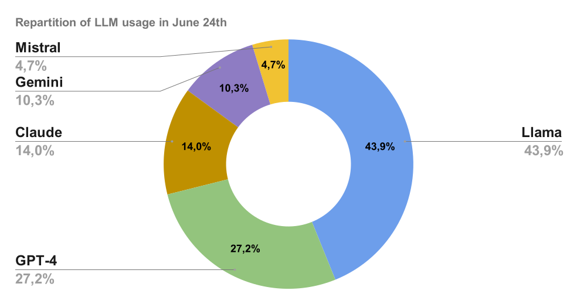

# Presentación del Índice de popularidad de los LLM

## Cómo se clasifican actualmente los LLM: rendimiento

En esencia, la forma actual de evaluar el rendimiento de los LLM consiste en crear consultas, enviar prompts a todos los modelos y evaluar la mejor respuesta. Este proceso se puede automatizar cuando se conoce de antemano la respuesta correcta (por ejemplo, en pruebas de matemáticas) o evaluar manualmente (como en Chatbot Arena).

1) Modelos ELO de Chatbot Arena: [LMSYS Chatbot Arena y clasificación](https://arena.ai/leaderboard)

2) Evaluaciones con puntuación: [LiveBench](https://livebench.ai/)

## Por qué hace falta un índice de popularidad

- Las clasificaciones de los LLM serán menos objetivas y más personales.
- Se tratará de decidir a quién queremos pedir consejo, ya que delegaremos cada vez más tareas en los LLM.
- La elección de un LLM dependerá menos de qué modelo da la respuesta correcta y más de cuál proporciona una respuesta pertinente.
- No se trata únicamente de obtener la respuesta correcta: elegir el mejor LLM también depende del gusto personal.
- Se trata de decidir a quién quieres pedir una opinión sobre tu problema. No seguir la recomendación de alguien no significa que no quieras escucharla o que no confíes en ella.
- Es un porcentaje y, por tanto, un valor estimado empíricamente.

## Índice de popularidad de los LLM: edición de junio de 2024

### GPT lidera frente a Claude y Gemini con una ventaja considerable

- Con el 27,2 % del total de prompts, GPT-4o supera a sus principales competidores.
- Claude recibió el 14 % del total de consultas en junio. Sin embargo, como mostramos en un estudio específico, su popularidad aumentó considerablemente tras el lanzamiento de Claude 3.5 Sonnet el 20 de junio.
- Tras el lanzamiento de Claude 3.5 Sonnet, Claude superó a Gemini 1.5 Pro en popularidad. Gemini representa el 10 % del total de prompts.
- Mistral Large representa el 4,7 % del total de consultas.

### ¿Cómo debemos interpretar la puntuación de Llama 3?

- En el estudio, Llama 3 se seleccionó como LLM predeterminado. Por tanto, el 45 % y el 47 % no se pueden considerar métricas matemáticamente justas para evaluar su popularidad; probablemente están sobrestimadas.
- Sin embargo, la excepcional velocidad de Llama 3 con Groq lo convierte en un serio candidato al modelo de IA más popular. (El equipo de Mammouth lo seleccionó como LLM predeterminado porque era su favorito personal.)
- El equipo tiene previsto revisar la configuración predeterminada de Mammouth (la interfaz donde se realizó el estudio) para obtener una cifra precisa de Llama 3 en el próximo estudio.

¿Se mantendrá esta popularidad o cambiará en el futuro?

Para seguir nuestro próximo estudio, síguenos en [LinkedIn](https://www.linkedin.com/company/mammouth-ai) o [X](http://x.com/mammouth_ai).

### **Metodología para evaluar empíricamente la popularidad de los LLM**

La popularidad se evalúa a partir de las elecciones de los usuarios en [Mammouth AI](https://mammouth.ai), una plataforma que permite enviar prompts a los mejores modelos de IA generativa desde un solo lugar.

Interfaz de prompts de Mammouth con acceso a las mejores versiones de LLM de GPT, Claude, Mistral, Llama y Gemini.

- Los 5 mejores modelos aparecen juntos en 5 botones del mismo tamaño.
- Cuando el usuario hace clic en un modelo de IA, recibe la respuesta del LLM seleccionado a su prompt.
- Si el usuario solo pulsa la tecla de acceso directo «Intro», recibe la respuesta de Llama.

Interfaz de conversación de Mammouth.

Después de enviar un prompt a un LLM, el usuario también puede:

- Seguir conversando con el modelo de IA seleccionado.
- Volver a enviar la consulta a otro LLM.

Para evaluar la popularidad de los LLM, contamos los prompts de cada modelo y usuario entre el 6 y el 30 de junio.

## Índice de popularidad de los LLM: todas las ediciones

[Consulta aquí el índice de popularidad de los LLM desde septiembre de 2024](../the-most-popular-llm/index.md).

## Más información

### Documentación

- [Lanzamiento de Claude 3.5 por Anthropic](https://www.anthropic.com/news/claude-3-family)

### Puedes probar 4 de los 5 LLM gratis en:

- [Probar Llama 3 70B de Groq](http://groq.com)
- [Probar GPT-4o](http://www.chatgpt.com)
- [Probar Mistral Large](https://chat.mistral.ai/chat)
- [Probar Claude](https://claude.ai/)

### O puedes usarlos todos en

- [Mammouth AI](http://mammouth.ai)
