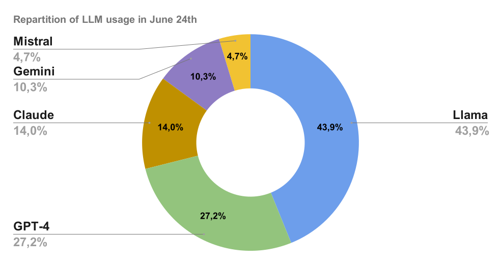

# Presentazione dell'indice di popolarità degli LLM

## Come vengono classificati oggi gli LLM: le prestazioni

In sostanza, il metodo attuale per valutare le prestazioni degli LLM consiste nel creare prompt, sottoporli a tutti gli LLM e valutare la risposta migliore. Il processo può essere automatizzato quando la risposta corretta è nota in anticipo (come nei test di matematica) oppure valutato manualmente (come nella Chatbot Arena).

1) I modelli Elo della Chatbot Arena: [LMSYS Chatbot Arena e classifica](https://arena.ai/leaderboard)

2) Benchmark con punteggi: [LiveBench](https://livebench.ai/)

## Perché serve un indice di popolarità

- La classifica degli LLM diventerà meno oggettiva e più personale.
- Sarà importante scegliere a chi chiedere consiglio, perché delegheremo sempre più attività agli LLM.
- La scelta di un LLM dipenderà meno da quale modello fornisce la risposta corretta e più da quale modello offre una risposta pertinente per noi.
- Non conta solo la risposta corretta: il miglior LLM dipende anche dai gusti personali.
- Si tratta di decidere di chi ascoltare un parere sul proprio problema: non seguire il consiglio di qualcuno non significa non volerlo ascoltare o non fidarsi di lui.
- È una percentuale e, quindi, una stima basata su dati empirici.

## Indice di popolarità degli LLM: edizione di giugno 2024

### GPT è nettamente in testa davanti a Claude e Gemini

- Con il 27,2% di tutti i prompt, GPT-4o supera i principali concorrenti.
- A giugno, Claude è stato utilizzato nel 14% delle richieste totali. Tuttavia, come dimostrato da uno studio specifico, la sua popolarità è aumentata notevolmente dopo il lancio di Claude 3.5 Sonnet il 20 giugno.
- Dopo l'uscita di Claude 3.5 Sonnet, la popolarità di Claude ha superato quella di Gemini 1.5 Pro, che rappresenta il 10% dei prompt totali.
- Mistral Large rappresenta il 4,7% delle richieste totali.

### Come interpretare il risultato di Llama 3?

- Nello studio Llama 3 è stato scelto come LLM predefinito. Pertanto, i valori del 45% e del 47% non sono una misura matematicamente imparziale della sua popolarità e probabilmente la sovrastimano.
- Tuttavia, la velocità eccezionale di Llama 3 fornito da Groq lo rende un serio candidato al titolo di modello di IA più popolare. (Il team Mammouth lo aveva scelto come LLM predefinito perché era il suo preferito.)
- Il team valuta di rivedere la configurazione predefinita di Mammouth, l'interfaccia usata per lo studio, per ottenere un dato più accurato su Llama 3 nel prossimo studio.

Questa popolarità resterà stabile o cambierà in futuro?

Per seguire il prossimo studio, segui Mammouth su [LinkedIn](https://www.linkedin.com/company/mammouth-ai) o [X](http://x.com/mammouth_ai).

### **Metodologia per valutare empiricamente la popolarità degli LLM**

La popolarità viene valutata in base alle scelte degli utenti su [Mammouth AI](https://mammouth.ai), una soluzione per interrogare i migliori modelli GenAI da un unico posto.

Interfaccia di prompting di Mammouth con accesso alle migliori versioni LLM di GPT, Claude, Mistral, Llama e Gemini

- I cinque modelli migliori sono mostrati insieme in cinque pulsanti della stessa dimensione.
- Quando l'utente fa clic su un modello di IA, riceve la risposta dell'LLM selezionato al proprio prompt.
- Se l'utente preme semplicemente il tasto di scelta rapida «Invio», riceve la risposta di Llama.

Interfaccia di conversazione di Mammouth

Dopo aver inviato un prompt a un LLM, l'utente può anche:

- Continuare a chattare con il modello di IA selezionato.
- Inviare di nuovo la richiesta a un altro LLM.

Per valutare la popolarità degli LLM, abbiamo quindi conteggiato i prompt per ciascun LLM e ciascun utente dal 6 al 30 giugno.

## Indice di popolarità degli LLM: tutte le edizioni

[Qui trovi le edizioni dell'indice di popolarità degli LLM da settembre 2024](../the-most-popular-llm/index.md).

## Approfondimenti

### Documentazione

- [Lancio di Claude 3.5 da parte di Anthropic](https://www.anthropic.com/news/claude-3-family)

### Puoi provare gratuitamente 4 dei 5 LLM su:

- [Prova Llama 3 70B di Groq](http://groq.com)
- [Prova GPT-4o](http://www.chatgpt.com)
- [Prova Mistral Large](https://chat.mistral.ai/chat)
- [Prova Claude](https://claude.ai/)

### Oppure usarli tutti su

- [Mammouth AI](http://mammouth.ai)
